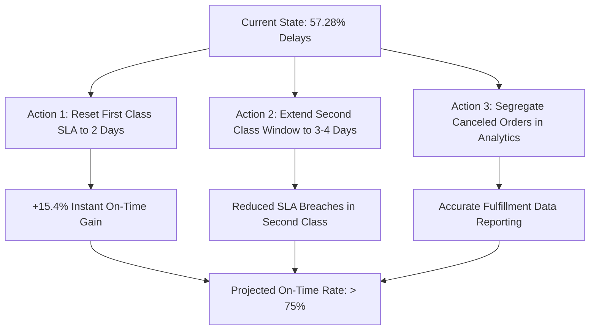

# Executive Summary: Global Supply Chain Delivery Performance & Logistics Efficiency

**Unified Mentor Machine Learning Fellowship**  
**Audience:** C-Suite, VP of Supply Chain, and Operations Directors  
**Dataset:** 180,519 Global Orders (`APL_Logistics.csv`)  

---

## 1. Executive Headline
Our empirical diagnostic of 180,519 global fulfillment orders reveals that **57.28% of all shipments fail their delivery SLA**. However, this high delay rate is **not** caused by global shipping distance, customer demographics, carrier failure, or regional customs bottlenecks. 

Instead, delays are systematically driven by an **unrealistic internal SLA model**:
- **First Class shipping is scheduled for 1 day, but physically requires 2 days, producing an artificial 100% delay rate.**
- **Second Class shipping is scheduled for 2 days, but actually requires 2 to 6 days (averaging 4.5 days), yielding a 79.73% delay rate.**
- When realistic transit times are scheduled (as in **Standard Class's 4-day window**), on-time fulfillment rises to **60.23%**.

---

## 2. Core Operational Metrics at a Glance

| Metric | Measured Value | Benchmark / Target | Status |
| :--- | :---: | :---: | :---: |
| **Total Global Shipments** | **180,519** | — | Validated Baseline |
| **On-Time Delivery Rate** | **42.72%** | > 85.0% | 🚨 Critical SLA Deficit |
| *— Arrived Early* | *24.02% (43,366)* | — | Favorable Buffer |
| *— Arrived Exactly on Schedule* | *18.70% (33,753)* | — | Exact Delivery |
| **Overall Delay Rate** | **57.28%** | < 15.0% | 🚨 Systemic Failure |
| **Average Delay Severity** | **1.62 days** | < 0.5 days | Operational Friction |
| **Average Signed Delivery Gap** | **+0.57 days** | $\le 0.0$ days | Net Schedule Deficit |
| **Late Delivery Risk Tagged** | **54.83%** | — | Risk Scoring Discrepancy |

---

## 3. High-Priority Operational Discoveries

### Priority 1: The First Class 1-Day Promise Fallacy
Across all 27,814 First Class shipments in the dataset, **not a single shipment arrived in 1 day**. In 100% of cases, fulfillment took 2 days. Promising next-day delivery without dedicated air-hub networks creates guaranteed customer dissatisfaction and damages company reputation.

### Priority 2: Regional and Demographic Parity
Global delivery performance does not vary significantly by geography:
- **LATAM:** 57.02% delay rate
- **Europe:** 57.69% delay rate
- **Pacific Asia:** 57.32% delay rate
- **USCA:** 57.15% delay rate
- **Africa:** 56.81% delay rate

Similarly, delivery performance across **Consumer**, **Corporate**, and **Home Office** accounts varies by less than 0.4%. High-value orders receive the exact same delivery timelines as low-value purchases (correlation $r \approx -0.004$).

### Priority 3: The Risk Metric & Cancellation Discrepancy
The internal metric `Late_delivery_risk` is tagged as `1` on 54.83% of orders, while true delivery delays stand at 57.28%. The 4,423-order difference consists entirely of **canceled shipments**. Because canceled shipments never completed customer hand-off, risk was tagged `0` despite transit delays.

---

## 4. Strategic Action Plan

1. **Reset First Class SLA to 48 Hours:**
   By updating customer-facing commitments from 1 day to 2 days, 27,814 shipments will immediately transition from SLA breaches to on-schedule arrivals. This change alone will increase global on-time fulfillment from 42.72% to **58.13%**.
2. **Re-engineer Second Class Carrier Contracts:**
   Transition Second Class to regional 3PL partners capable of guaranteed 48-hour delivery, or extend the customer expectation window to 3–4 business days.
3. **Align Commercial Tiers with Logistics Priority:**
   Currently, high-value B2B corporate orders experience the same delays as single consumer orders. Introduce tier-based dispatch prioritization for high-margin corporate accounts.

---

## 5. Summary Conclusion
The global supply chain logistics network is structurally sound, achieving stable 2-to-4 day fulfillment worldwide. The primary driver of "delays" is not operational breakdown, but marketing and scheduling commitments that misrepresent physical logistics reality. Aligning promised SLAs with empirical delivery capabilities will immediately restore operational credibility and customer trust.
